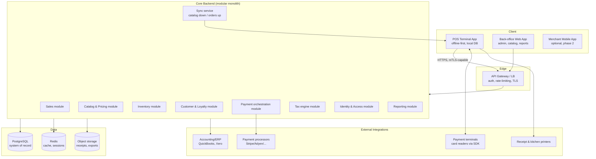
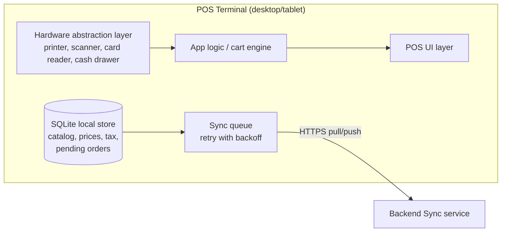

# POS System — Architecture Design (v0.1 Draft)

> **Status:** Draft for review — not yet finalized.
> **Purpose:** First-pass architecture to align on scope, structure, and technology before implementation begins.

---

## 1. Scope & Working Assumptions

No functional requirements were provided yet, so the design below assumes a **general-purpose retail Point-of-Sale system**. Each assumption is flagged and should be confirmed or corrected in the review round.

| # | Assumption | Confidence |
|---|-----------|------------|
| A1 | Multi-tenant SaaS: one deployment serves many merchants (single-tenant deployment is a smaller change later) | To confirm |
| A2 | Retail focus (barcode scanning, stock) with a path to food-service/restaurant mode later | To confirm |
| A3 | Cloud-hosted backend; terminals must keep working during internet outages (**offline-first**) | To confirm |
| A4 | Multi-location support per merchant (stores, warehouses) | To confirm |
| A5 | Payments via third-party processors (Stripe, Adyen, Square, local PSPs) — we do **not** build card processing ourselves | High |
| A6 | Targets: up to ~500 merchants, ~5,000 terminals, ~50 orders/merchant/day initially | To confirm |

---

## 2. High-Level Architecture

Modular monolith on the backend (not microservices) with a thin, hardware-facing terminal client. Rationale in §7.

### Key architectural properties

1. **Offline-first terminals.** The terminal holds a local database (SQLite) with catalog, prices, and tax rules. Sales are created locally and queued; sync pushes orders up and pulls catalog/tax updates down. Terminals remain fully functional for cash and queued card payments during outages.
2. **Backend is the system of record.** The terminal DB is a *cache*, never authoritative. Conflict resolution: orders are immutable once synced (append-only), inventory adjustments use monotonic event journal to survive replay.
3. **Payment orchestration, not payment processing.** We integrate PSPs and hardware terminals via their SDKs; card data never touches our systems (SAQ-A/EP scope minimization).
4. **Event-driven internals.** Domain events (`OrderCompleted`, `StockAdjusted`, `PaymentCaptured`) flow through an in-process dispatcher now, with an option to externalize to a message broker later without changing module contracts.

---

## 3. Module Breakdown (Core Backend)

| Module | Responsibility | Key entities |
|--------|---------------|--------------|
| **Identity & Access** | Merchants, users, roles, API keys, sessions, audit log | Merchant, User, Role, ApiKey |
| **Catalog & Pricing** | Products, variants, barcodes, price books, promotions/discounts | Product, Variant, PriceBook, Promotion |
| **Inventory** | Stock per location, receiving, transfers, shrinkage, low-stock alerts | StockLevel, StockMovement, PurchaseOrder |
| **Sales** | Orders/carts, returns/refunds, receipts, shifts/cash-drawer (Z-reports) | Order, OrderLine, Return, Shift |
| **Payment orchestration** | PSP routing, terminal handoff, retries, reconciliation, settlements | Payment, Refund, Settlement |
| **Tax engine** | Configurable tax rules per jurisdiction, inclusive/exclusive prices | TaxRule, TaxRate |
| **Customer & Loyalty** | Customer profiles, loyalty points, stored value (gift cards) | Customer, LoyaltyAccount, GiftCard |
| **Reporting** | Sales analytics, X/Z reports, export pipeline | Read models (materialized views) |
| **Sync service** | Terminal provisioning, catalog snapshot distribution, order ingestion queue | SyncJob, DeviceSession |

**Ground rules:**
- Modules communicate only through their published service interfaces + domain events — no cross-module DB joins. This keeps the monolith honest and preserves the option to split modules out later.
- One PostgreSQL schema per module (logical separation), single physical database.

---

## 4. Terminal Client Design

- **Hardware abstraction layer (HAL):** all device access goes behind one interface so we can support different printer/card-reader vendors without touching app logic.
- **Sync protocol:** catalog changes are versioned; terminal pulls deltas by version cursor. Orders are pushed idempotently (client-generated ULID keys); server deduplicates.
- **Clock discipline:** all timestamps recorded with terminal offset vs. server time on sync; never trust terminal clocks for reporting.

---

## 5. Data Model — Core (draft ERD)

```mermaid
erDiagram
    MERCHANT ||--o{ LOCATION : has
    MERCHANT ||--o{ USER : has
    LOCATION ||--o{ STOCK_LEVEL : holds
    PRODUCT ||--o{ VARIANT : has
    VARIANT ||--o{ BARCODE : has
    VARIANT ||--o{ STOCK_LEVEL : stocks
    PRICE_BOOK ||--o{ PRICE : contains
    VARIANT ||--o{ PRICE : priced
    ORDER ||--|| SHIFT : "recorded in"
    ORDER ||--o{ ORDER_LINE : contains
    ORDER_LINE }o--|| VARIANT : references
    ORDER ||--o{ PAYMENT : settled_by
    PAYMENT }o--|| PAYMENT_METHOD : uses
    ORDER }o--o| CUSTOMER : "optionally for"
    CUSTOMER ||--o| LOYALTY_ACCOUNT : has
```

Money handling: **integer minor units** (cents) everywhere; currency is a column, never assumed. All financial tables append-only where feasible (orders immutable post-sync; corrections via linked reversal records).

---

## 6. Technology Stack (proposal)

| Layer | Choice | Rationale |
|-------|--------|-----------|
| Backend | **Python (FastAPI)**, modular monolith | Fast iteration, strong typing via Pydantic, huge ecosystem, easy hiring |
| Database | **PostgreSQL 16** | ACID, rich types (JSONB, numerics), logical replication for read replicas |
| Cache/session | **Redis** | Sessions, idempotency keys, rate limits |
| Terminal app | **Electron + TypeScript/React** or **Flutter** | Cross-platform desktop/tablet; decision point at kickoff (see §7) |
| Back-office web | **TypeScript/React (SPA)** | Shared types with terminal if TS chosen |
| Local terminal store | **SQLite (WAL mode)** | Embedded, reliable, single-file backup |
| Payments | PSP SDKs (Stripe Terminal / Adyen / local PSPs) | No card data in our stack (PCI scope reduction) |
| Infra | Docker, single cloud (AWS/GCP), Terraform from day one | Reproducible environments |
| CI/CD | GitHub Actions; migrations via Alembic | Standard, boring, auditable |

**Deployment shape:** one backend deployment per region; merchants pinned to a region. Terminals communicate only with their region's API.

---

## 7. Key Decisions & Open Questions (ADR-style)

| ID | Decision | Alternatives considered | Rationale |
|----|----------|------------------------|-----------|
| D1 | Modular monolith over microservices | Microservices, serverless | Team scale; microservices add ops burden with no benefit at current size; module boundaries keep future split cheap |
| D2 | Offline-first terminals | Thin clients, online-only | POS must survive network outages; revenue cannot stop when the internet does |
| D3 | Third-party PSPs, no in-house card processing | Build own processing | PCI burden and licensing costs are prohibitive; integration is a solved problem |
| D4 | PostgreSQL single DB, per-module schemas | DB-per-service, NoSQL | Transactions across modules (orders+stock+payments) must be consistent; relational fits domain |
| D5 | Integer minor units for money | Floats, Decimal | Decimal is viable but ints are unambiguous across serialization boundaries; document loudly |
| **Q1** | Terminal stack: Electron+React vs Flutter | — | Affects team skills, UI perf on low-end hardware, offline tooling. **Needs your input** |
| **Q2** | Multi-tenant SaaS vs single-tenant per merchant | — | Changes isolation model, migrations, pricing. **Needs your input** |
| **Q3** | Target vertical(s): retail, food service, or both at launch? | — | Affects catalog model (variants/modifiers), order flow, kitchen printers. **Needs your input** |
| **Q4** | Which PSP markets/countries at launch? | — | Determines tax engine complexity and PSP choice. **Needs your input** |

---

## 8. Cross-Cutting Concerns

- **Security:** OAuth2/OIDC for back-office; device tokens + mTLS-capable channel for terminals; row-level tenant isolation enforced in repository layer (and Postgres RLS as backstop); audit log for all privileged actions; no card data stored (SAQ-A).
- **Observability:** structured logs (JSON), OpenTelemetry traces, Prometheus metrics from day one; per-terminal sync lag as a first-class metric.
- **Idempotency:** all mutating API endpoints accept idempotency keys; sync uploads are naturally idempotent via ULIDs.
- **Backups/DR:** PostgreSQL PITR; RPO ≤ 5 min, RTO ≤ 1 h for core; terminals tolerate indefinite backend outage by design.
- **Compliance hooks (planned, not built yet):** fiscal printers/tax authority integrations vary by country — isolated behind the Tax engine + Receipt module interfaces so country-specific logic never leaks into core.

---

## 9. Delivery Roadmap (proposed phases)

| Phase | Content | Exit criteria |
|-------|---------|--------------|
| **P0 — Foundation** (2–3 wks) | Repo scaffolding, CI, auth, merchant/location model, skeleton modules | Deployable "hello" stack with auth |
| **P1 — Sell** (4–6 wks) | Catalog, pricing, order flow, cash payments, receipts, SQLite terminal sync | Single store can trade offline and reconcile |
| **P2 — Payments** (3–4 wks) | One PSP integration, card-present flow, refunds, reconciliation | End-to-end card sale + refund |
| **P3 — Operate** (3–4 wks) | Inventory, returns, shifts/Z-reports, back-office reporting | Merchant can run daily ops without DB access |
| **P4 — Scale** | Loyalty, multi-location, promotions engine, mobile app | Per roadmap agreed after P1 learnings |

---

## 10. Risks

| Risk | Mitigation |
|------|-----------|
| Sync conflicts corrupt inventory | Event-journal design + idempotent ingestion; inventory count reconciliation workflow |
| PSP/hardware SDK quirks dominate P2 | HAL isolation; pick PSP early; spike in P0/P1 |
| Tax/fiscal complexity explodes with countries | Tax engine interface + per-jurisdiction plugins; Q4 must be answered before P2 |
| Terminal hardware variety (printers, readers) | HAL contract frozen in P1; vendor certification checklist |
| Scope creep toward ERP features | Explicit phase gates; reporting read models keep core lean |

---

*Next step: resolve Q1–Q4 with stakeholders, then freeze this document as v1.0 and scaffold the P0 codebase.*