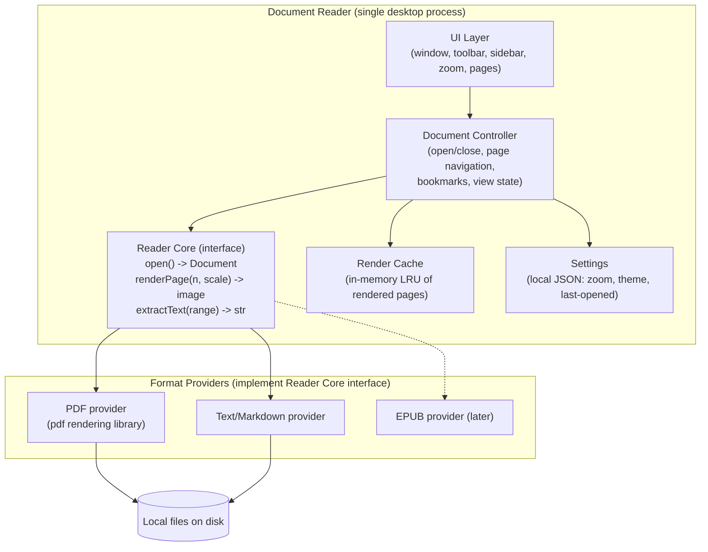

# Document Reader — Architecture Design (v0.1 Draft)

> **Status:** Draft for review.
> **Goal:** A simple, local desktop application to open and read documents. Kept intentionally minimal — no server, no cloud, no accounts.

---

## 1. Working Assumptions (to confirm)

| # | Assumption | Confidence |
|---|-----------|------------|
| A1 | **Desktop app** for viewing documents stored on the local disk | To confirm |
| A2 | Formats at launch: **PDF**, plus plain text / Markdown (EPUB optional later) | To confirm |
| A3 | Single-window viewer: open a file, read it, close it | To confirm |
| A4 | **English-first UI**; no OCR in v1 (only if scanned-PDF support is required) | To confirm |
| A5 | Runs on Windows, macOS, and Linux from one codebase | To confirm |
| A6 | No editing, no annotation, no cloud sync in v1 | To confirm |

---

## 2. Architecture Overview

A single desktop application with a **rendering core** isolated behind an interface. This is the one structural decision that matters: it keeps format parsing (the messy part) swappable and testable, while everything else stays plain app code.



**Flow:** user opens a file → controller picks a provider by extension/MIME → provider parses lazily (page-by-page, not whole-file) → controller asks provider to render a page at current zoom → result cached in an LRU cache → UI displays it. Memory stays flat no matter how large the document is, because only a page window is rendered at a time.

---

## 3. Module Breakdown

| Module | Responsibility |
|--------|---------------|
| **UI layer** | Window, page view, toolbar (open, zoom, page nav), optional sidebar (page thumbnails), theme |
| **Document controller** | App-level state machine: current document, current page, zoom, scroll position; routes user actions |
| **Reader core (interface)** | The contract above — the only seam between the app and format libraries |
| **PDF provider** | Lazy page iteration, rasterization to images, embedded text extraction, metadata (title, page count) |
| **Text/Markdown provider** | Simplest provider: read file, paginate on demand, render as text view |
| **Render cache** | LRU keyed by `(doc_id, page, scale)`; sized by memory budget (e.g., 200 MB) |
| **Settings** | Small local JSON file; no registry, no cloud |

No database. No background services. If a file is opened twice, it's simply opened twice.

---

## 4. Key Interfaces (sketch)

```python
class Document(Protocol):
    title: str
    page_count: int
    def close(self) -> None: ...

class ReaderProvider(Protocol):
    def open(self, path: Path) -> Document: ...
    def render_page(self, doc: Document, page: int, scale: float) -> Image: ...
    def extract_text(self, doc: Document, page: int) -> str: ...
```

The controller knows nothing about PDFs. A new format = one new provider file. All providers are unit-testable with real sample files, no UI needed.

---

## 5. Technology Options

Two viable stacks; the choice is mainly about team preferences and platform targets.

| Concern | Option A: **Tauri + Rust** | Option B: **Electron + TypeScript** |
|---------|---------------------------|-------------------------------------|
| PDF rendering | `pdfium` bindings — high quality, fast | `pdf.js` — mature, pure JS |
| Memory footprint | Low (~50 MB idle) | Higher (~200 MB idle) |
| Packaging size | ~10 MB | ~100+ MB |
| Dev velocity | Slower if team is not Rust-fluent | Fastest if team knows web tech |
| Text/Markdown | Trivial in both | Trivial in both |

**Recommendation:** Option A (Tauri + pdfium) for footprint and native feel, unless the team is web-only — then Option B. This is **Q1** below.

---

## 6. Key Decisions

| ID | Decision | Rationale |
|----|----------|-----------|
| D1 | Single desktop app, no server component | The task is "read documents"; adding services would re-create the complexity we just avoided |
| D2 | Provider interface as the only architectural seam | Keeps format-specific code isolated and swappable without over-engineering |
| D3 | Lazy, page-windowed rendering + LRU cache | Constant memory for any file size; this is the pattern every serious viewer uses |
| D4 | No OCR in v1 | OCR is a large dependency (models, accuracy work); only pursue if scanned-PDF reading is a hard requirement |
| D5 | Plain files, no database, no sync | Nothing in the requirements justifies persistence beyond a small settings file |

---

## 7. Open Questions (need your input)

| # | Question | Why it matters |
|---|----------|----------------|
| Q1 | Tech stack: Tauri+Rust or Electron+TypeScript? | Determines language, packaging, and PDF library |
| Q2 | Which OS platforms at launch? Windows-only would simplify v1 | Test matrix size |
| Q3 | Are **scanned PDFs** (image-only, no text layer) in scope for v1? | If yes, we need OCR or at least image-rendering-only mode + zoom |
| Q4 | Target formats beyond PDF: TXT/MD only, or also EPUB/DOCX? | EPUB is cheap; DOCX is not trivial |
| Q5 | Nice-to-haves for v1: dark mode, bookmarks, full-text search? | Search is the most valuable and the trickiest — worth deciding early |

---

## 8. Roadmap (proposed)

| Phase | Content | Exit criteria |
|-------|---------|--------------|
| **P0 — Skeleton** (~1 wk) | App shell, open-file dialog, provider interface stub, CI + packaging script | App launches, opens a file, shows metadata |
| **P1 — Read PDF** (~2 wks) | PDF provider, page rendering, zoom, page navigation, LRU cache | Smooth reading of a 500-page PDF at stable memory |
| **P2 — Text & polish** (~1–2 wks) | TXT/MD provider, settings persistence, dark mode, packaging installers | Usable v1 installers for target OS(s) |
| **P3 — Extensions** (optional) | Full-text search, bookmarks, EPUB, thumbnails sidebar | Per decisions after P2 |

---

## 9. Risks

| Risk | Mitigation |
|------|-----------|
| Odd PDFs (corrupt, huge, unusual encodings) crash the app | Provider-level error containment; fuzz a corpus of bad files in P1; renderer is in-process but sandboxed by provider API |
| Memory blow-up on large documents | Lazy rendering + LRU cache is the whole defense; add memory assertions in CI |
| Scope creep toward editing/annotation | Roadmap gates; annotation explicitly out of scope for v1 (A6) |
| Cross-platform quirks (fonts, HiDPI) | Test matrix fixed early by Q2; pdfium/WebView handle most of it |

---

*Next step: resolve Q1–Q5, then freeze as v1.0 and scaffold the P0 app shell.*