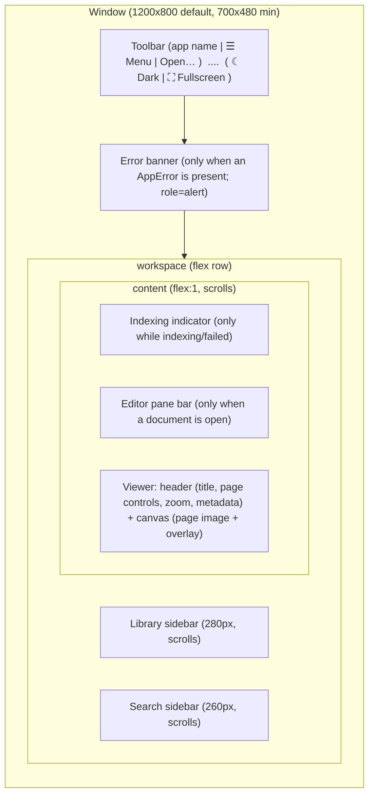

# Document Reader — UX Specification (v1.0)

> **Status:** DERIVED — reverse-documented from the implementation at `0.3.0`
> (`p2-windows-test`, `1560b09`). Authoritative for the surfaces it describes; it
> describes what **ships**, not what was hoped for.
> **Feeds the design pipeline:** every requirement carries a stable `UX-###` id, a
> surface, its states, and acceptance criteria, so a `docs/P<n>-DESIGN.md` can cite a
> requirement and a test can assert it. This document does not re-litigate frozen
> decisions (`DECISIONS.md`); it renders them as user-visible behaviour.
> **Companion docs:** `ARCHITECTURE.md` (system), `DECISIONS.md` (product/scope),
> `P1.9-DESIGN.md` (the phase-doc template this follows), `P2-DESIGN.md`,
> `P2.4-DESIGN.md`.

---

## 0. How to use this document

This is the **UX contract** for the app. Three rules make it pipeline-ready:

1. **Requirement ids are stable.** `UX-###` never renumber. A phase design that changes a
   surface must cite the id it amends, exactly as phase docs cite `D`/`T` numbers.
2. **Every requirement names its surface, its states, and how to accept it.** If it
   cannot be accepted, it is marked *(manual)* — the app is a native GUI and cannot run
   headless (see `README.md`), so some acceptance is a recorded manual checklist, the same
   convention as `P1.9-DESIGN.md` §7.
3. **Source is the tie-breaker.** Where this document and the code disagree, the code wins
   and this document is a defect to fix in the same PR.

Requirement ids are grouped by prefix-free numeric blocks so a phase can reserve a range:

| Range | Area |
|-------|------|
| UX-1xx | Shell, toolbar, information architecture |
| UX-2xx | Reading (open, pages, zoom, keyboard, fullscreen/focus, theme) |
| UX-3xx | Library and search |
| UX-4xx | Annotation editing |
| UX-5xx | Page tools, export, watermark, save discipline |
| UX-6xx | In-place text editing (P2.4 stages 1–2) |
| UX-7xx | Feedback, errors, disclosure, accessibility |

---

## 1. Product frame and UX principles

**Product:** a local-first personal-library document reader with editing (per
`README.md`, `DECISIONS.md` §0). Windows-only v1; the window opens at **1200×800**, with a
floor of **700×480** (`tauri.conf.json`), and every layout decision must hold at 700px wide.

The principles below are not aspirations — each is already enforced by a frozen decision.
They are the tests a new surface is held to.

| # | Principle | Enforced by | Visible as |
|---|-----------|-------------|------------|
| **P1** | **The original file is never silently changed.** | `P2-D2`, `P2.4-T8` | Every write says where it went; "overwrite" is a separate confirmed flow |
| **P2** | **Refuse loudly, never mangle silently.** | `P2.4-Q2/T3` | Pre-computed refusal text; a word that cannot be edited still shows a target that explains why |
| **P3** | **The page is the primary surface; chrome is optional.** | `P1.9-D1` | Focus/fullscreen hides panes; the slim toolbar stays as the escape hatch |
| **P4** | **Reading is keyboard-first.** | `P1.9-D4`, `ViewerPane` | Arrows/PageUp/Down/Home/End, F11, Escape — before any on-screen control |
| **P5** | **Calm beats alarming.** | `P2.4-T7` | A password-protected file opens and reads; a quiet banner, nothing modal |
| **P6** | **No dead UI.** Only working features appear. | `P1.9` §0, `Menu.tsx` | The menu contains nothing the backend cannot do |
| **P7** | **One keystroke, one effect.** | `P1.9` implementation note 2 | Escape closes the menu *or* leaves fullscreen, never both |
| **P8** | **Progressive disclosure of power.** | `P2-D9`, `EditorPane` | Edit tools appear in their own pane bar; style controls only when a tool is active |

---

## 2. Information architecture

### 2.1 Window regions



`chromeHidden` (focus mode) sets `display:none` on **Library sidebar, Search sidebar and the
metadata block** — nothing else. The toolbar and the viewer's page controls deliberately
stay (`P1.9-D8`): a mouse user must never be stranded.

### 2.2 Regions

| Region | Component | Always present? | Purpose |
|--------|-----------|-----------------|---------|
| Toolbar | `Toolbar.tsx` | yes | App name, the single `☰ Menu`, `Open…`; right side: theme toggle, fullscreen toggle |
| Error banner | `LibraryPane.tsx::ErrorBanner` | only on error | One line, `code` + `message`, `role=alert` |
| Library sidebar | `LibraryPane.tsx` | yes (hidden in focus) | The library; empty state when none |
| Search sidebar | `SearchPane.tsx` | yes (hidden in focus) | Query box + results |
| Indexing indicator | `SearchPane.tsx::IndexingIndicator` | only while running/failed | Per-document index progress |
| Editor pane bar | `EditorPane.tsx` | only with a document | Annotation tools, style, page/export tools, save actions, text edit |
| Viewer | `ViewerPane.tsx` | yes | Title, page controls, zoom, metadata, page image, overlays |

### 2.3 Modes

| Mode | Trigger | Effect |
|------|---------|--------|
| Reading | default | Page + chrome + overlays |
| Focus (`chromeHidden`) | Menu → Hide side panels, or entering fullscreen | Panes + metadata hidden; toolbar stays; persisted (`reading.chromeHidden`) |
| Fullscreen | F11 / ⛶ / Menu | OS window fullscreen **and** focus mode together (`P1.9-D1`) |
| Annotation tool active | A tool button in the editor pane | Overlay becomes a capture surface; style row appears |
| Text-edit mode | "Edit text on this page" | Text-run picker replaces the annotation overlay; Escape exits |

---

## 3. Reading experience

### 3.1 Opening

- `Open…` (toolbar and File menu) opens the **native** file dialog filtered to
  `pdf, txt, md`; single selection. While opening, the button reads `Opening…` and is
  disabled (**UX-201**).
- Open inserts/selects in the library, selects it, and **starts on page 1** — a pending
  jump is dropped so the previous document's position never bleeds in (**UX-202**).
- Failure surfaces as a banner; `PDFIUM_UNAVAILABLE` carries the remediation hint
  (see §7).

### 3.2 Page navigation and zoom

| Control | Behaviour |
|---------|-----------|
| `‹` / `›` | Previous / next page; disabled at the ends (`page===0`; `page>=last`) |
| Page indicator | `n / total`, or bare `n` until the count resolves |
| Zoom select | Fixed ladder **50 / 75 / 100 / 150 / 200 / 300 %**; **default 200 %** (`DEFAULT_ZOOM`) |
| Keyboard | `→`/`PageDown` next, `←`/`PageUp` previous, `Home` first, `End` last (**UX-204**) |

- A page turn does not reflow the layout: the `` carries explicit pixel `width`/`height`
  from the backend so the container is sized before the PNG decodes (`P1-D2`) (**UX-205**).
- Zoomed pages **scroll**; the raster is never downscaled to fit (`ViewerPane`) (**UX-206**).
  Layout hazard, do not regress: a scrolling container must centre with `margin:0 auto`, never
  flex `justify-content`/`align-items` — that clips the far edge beyond the scroll range
  (`P1.9.1`).
- Rendering shows a quiet `Rendering page…` while a render is in flight; a superseded
  response is dropped rather than flashed (**UX-207**).

### 3.3 Fullscreen and focus

- Three entry points flip **one** state: F11, the `⛶` toolbar button, and
  Menu → View (**UX-208**).
- Entering fullscreen snapshots the current chrome state and hides the panes; **Escape
  restores exactly what it was** — a user who had panes hidden before fullscreen must not
  get them back (`P1.9-D4`) (**UX-209**, *manual* — verified on Windows in `P1.9` §10).
- The window, not React state, is the source of truth: every toggle reads → requests →
  reads back, and a `resize` listener re-syncs if the OS leaves fullscreen itself
  (`P1.9-D11`) (**UX-210**).
- If the window did not change, the UI must not claim it did: a failed fullscreen request
  toggles nothing and shows a banner (**UX-211**).
- Fullscreen is **never restored on launch**; only a user-initiated chrome toggle persists
  (`P1.9-D3` + implementation note 3) (**UX-212**).

### 3.4 Theme

- One toggle; label flips `☾ Dark` / `☀ Light`; the choice applies before first paint via
  `localStorage` and is durably mirrored to `AppState` key `theme`; the DB copy wins on
  read-back (**UX-213**).

---

## 4. Library and search

### 4.1 Library

- Empty state: *"Your library is empty."* + *"Use “Open…” to add a PDF, TXT, or Markdown
  file."* (**UX-301**).
- Each row: title (`(untitled)` fallback), then `FORMAT · N pages`, plus
  `· file moved or deleted` when `missing` (**UX-302**).
- Selection highlights the row; selecting never moves the viewer except to page 1 of the
  newly selected document (**UX-303**).

### 4.2 Search

- Query box placeholder `Search text…`, debounced **200 ms**, `limit 50` (**UX-311**).
- A hit shows **document title · `p. N` · snippet**, plus a `note` badge when the hit came
  from an annotation rather than the document text (`P2-D5`) (**UX-312**).
- Clicking a hit selects the document and jumps the viewer to the page; a hit inside an
  annotation on another page navigates the viewer too (`P2-D5c`) (**UX-313**).
- Clicking the same hit twice re-navigates (nonce semantics) (**UX-314**).
- Empty result: *"No matches. Text is indexed when a document is opened, so a document added
  before now may still be indexing."* — deliberately explains the likely cause (**UX-315**).
- Snippets are rendered as text; FTS5's `[ ]` match markers are never interpreted as HTML
  (**UX-316**).

### 4.3 Indexing feedback

| State | Presentation |
|-------|--------------|
| Running, total unknown | `Indexing…` (no `0 / 0`) |
| Running, total known | `Indexing d / t` + a progress bar |
| Failed | `Indexing failed; search will miss this document.` + **Retry** |
| Never indexed / done | nothing shown |

Status survives a remount by being read back, not only via the event (`P1-D6`) (**UX-317**).

---

## 5. Annotation editing

Entered by choosing a tool in the editor pane bar. Choosing the active tool again turns it
off, so returning to reading needs no "select" tool (**UX-401**).

| Tool | Gesture | Stored as | Default style |
|------|---------|-----------|---------------|
| Highlight | drag over text | rects | `#fff3b0` @ 0.4 |
| Underline | drag under text | rects | `#1f6feb` @ 1 |
| Strike out | drag over text | rects | `#d1242f` @ 1 |
| Note | click, then type | one anchor point (expands to a 20 pt square) | `#f5a623` @ 1 |
| Ink | drag to draw | strokes | `#111418` @ 1 |
| Box | drag | rect | `#1f6feb` @ 1 |

- A note captures its text **before** the row is written: a note with no text is a pin with
  nothing pinned to it (**UX-402**).
- The style row (Colour from a 6-swatch set, Opacity slider 0.1–1 step 0.1) appears **only
  when a tool is active**, and the per-tool choice is remembered across sessions under
  `annotation.style.<tool>` (`P2-D10`) (**UX-403**).
- Saved marks are drawn as live DOM over the page; a selected mark shows an accent outline;
  selecting enables **Delete annotation** (**UX-404**).
- Marks are drawn from the DB row, not stamped into the raster; the overlay and the exported
  PDF must agree on position — geometry lives in one shared module, mirrored in Rust
  (`P2-D3`, `P2.4-T2`) (**UX-405**).
- **View original / View annotated** (Menu → View, default *annotated*) suppresses the
  annotation layer **at render time**, not by hiding DOM, so pixels and overlay cannot
  disagree (`P2-D9`) (**UX-406**).
- Undo/redo: session-scoped, per document, cap 100, buttons disabled when empty (`P2-D7`)
  (**UX-407**). Undoing a delete restores the **original id** and its FTS row (**UX-408**).

---

## 6. Page tools, export, save discipline

### 6.1 Page and export tools

Single controls, all keyed off a **Page** number that follows the visible page until typed
over (**UX-501**): **Rotate 90° · Delete page · Extract page · Split here · Export
flattened · Export with watermark · Watermark a copy**. Watermark actions are disabled until
the watermark text is non-empty.

Every one of these **writes a new file**; a standing caption says so: *"These write a new
file. The original is never changed."* (**UX-502**).

### 6.2 Save flows

| Action | Flow |
|--------|------|
| **Save edits…** | Resolves the target, then a confirm dialog naming it: *Save edits as `<path>`?* + *"Your original file will not be changed."* → **Save** / **Cancel** |
| **Overwrite original…** | A **separate** danger confirm: *Overwrite `<path>` with your annotations?* + *"This replaces the original file. It cannot be undone from here."* → **Overwrite** / **Cancel** |
| Success | A status line: *Saved to `<path>`* |
| **Decrypt a copy…** | §6.3 |

- The save target is `"{stem} (edited N).pdf"` alongside the original; N is monotonic
  (`P2-D2`) (**UX-511**).
- Overwrite is never reachable from *Save edits*; naming the actual file in both dialogs is
  required — the user confirms a specific document, not an abstract "overwrite?" (**UX-512**).
- Derived-file names (`report (rotated 1).pdf`) must never use the `(edited N)` form
  — that namespace belongs to the edit-copy GC (**UX-513**).

### 6.3 Encrypted documents

- A password-protected file **opens and reads normally**; a calm inline banner states
  *Password-protected · Opened read-only. Use “Decrypt a copy…” … the original stays
  protected.* Nothing is modal (**UX-521**, `P2.4-T7`).
- Editing UI is not offered: the text-edit panel is replaced by a sentence pointing at
  *Decrypt a copy…*; every edit command would refuse `ENCRYPTED_READ_ONLY` anyway (**UX-522**).
- **Decrypt a copy…** is a three-step deliberate flow: open the form → read what it does
  (*"Protection will be removed on the new copy only… Nothing is re-encrypted."*) → enter
  the password → **Decrypt a copy**. The password field is autofocused and cleared as soon
  as the call returns, pass or fail; it is never persisted, logged, or emitted
  (`P2.4-T8/T10`) (**UX-523**).
- There is **no automatic password prompt** and no re-encryption, ever (`P2.4-Q4/T9`)
  (**UX-524**).

---

## 7. In-place text editing (P2.4)

### 7.1 The picker

- **Edit text on this page** turns on the picker; the text-run layer **replaces** the
  annotation overlay rather than stacking on it — two live pointer layers would make a click
  ambiguous (**UX-601**).
- Every run is boxed: dashes = editable, red = refused. **A refused run stays visible and
  clickable** — clicking explains the gate; hiding it would read as a broken picker
  (**UX-602**, principle P2).
- Alongside the boxes, the panel lists the runs with font name/size and the gate name, so a
  densely typeset page can be picked from a list (**UX-603**).
- Verdicts are **pre-computed and shown before typing** — *"None of this page's text can be
  edited in place. Add a text annotation instead."* when nothing is editable (**UX-604**).
- Escape leaves the picker (capture phase, so it cannot also drop fullscreen) (**UX-605**).

### 7.2 The edit form

- Header *Replace `<run text>` with* + a text input prefilled with the run; **Apply text
  edit** is disabled until the text differs (**UX-611**).
- A refusal shows the backend's sentence **verbatim** — for the width gate it quotes **both**
  measured widths and suggests the annotation tool (`P2.4-T3d`) (**UX-612**).
- The **substitute** checkbox (default on) allows a standard-14 font to replace a font that
  cannot set the new text; turning it off turns such edits into `SUBSTITUTE_REFUSED`
  (`P2.4-stage2 O-ST2-4`) (**UX-613**).
- A successful edit **writes a new file** and states it: *"Writes a new file. The original
  is never changed."* (**UX-614**).

### 7.3 Disclosure and refusals

- When substitution fires, a **verbatim** notice names the substitute:
  *"edited with Helvetica substituting ABCDEF+TimesNewRoman"*, dismissible; a paraphrase is
  forbidden because it could hide which font the run now uses (`T10`) (**UX-621**).
- Refusal codes and their surfaces are fixed (**UX-622**):

| Code | Shown where |
|------|-------------|
| `TEXT_RUN_NOT_EDITABLE` | Text-edit panel, next to the run |
| `TEXT_RUN_MISMATCH` | Text-edit panel |
| `CONTENT_TOO_LARGE` | Text-edit panel |
| `GLYPHS_NOT_COVERABLE` | Text-edit panel |
| `SUBSTITUTE_REFUSED` | Text-edit panel |
| `ENCRYPTED_READ_ONLY` | Text-edit panel (read-only case) / editor error |
| `WRONG_PASSWORD` | Decrypt form |

Any other error falls through to the editor pane's own error region; the two sets are
**disjoint**, so no message appears twice (**UX-623**).

---

## 8. Feedback, errors, and disclosure

### 8.1 Error surfaces

| Surface | Scope | Form |
|---------|-------|------|
| Error banner | App-level (`open`, fullscreen) | `code` + `message`, `role=alert` |
| Editor error region | Editing failures | message + **Dismiss** |
| Text-edit panel | Text-edit refusals | verbatim sentence, `role=alert`/`status` |
| Menu error line | Bookmark failures | `code: message` |
| Index status | Index failure | message + **Retry** |

Rules: errors are **typed** (`{code, message}`), the frontend switches on `code`, never on
string matching (**UX-701**). User-facing vocabulary never leaks internals: a non-renderable
format says *"This format cannot be displayed as pages."*, not a stack trace (**UX-702**).

### 8.2 Empty and quiet states (all deliberate)

Library empty · Document-not-open (*"No document open."* + how to open one) · Search empty ·
Search no-matches · No bookmarks (*"No bookmarks yet."*) · No document to bookmark
(*"Open a document to bookmark pages."*) · No editable text · Rendering · Indexing ·
Password-protected read-only. Each names the state and, where useful, the way forward
(**UX-703**).

### 8.3 Menu

One `☰ Menu` button opens one panel — not a row of dropdown roots — because the toolbar must
survive 700px and focus handling must live in one place (`P1.9-D5/D9`) (**UX-711**).

```
File        Open…
View        Enter/Exit fullscreen (F11) · Hide/Show side panels · View original/annotated
Go          First page (Home) · Previous (←) · Next (→) · Last page (End)
Bookmarks   Add bookmark (page N) · list with remove (✕) · empty state
```

- Closes on outside click, on Escape, and on activation; the button carries `aria-expanded`
  (**UX-712**).
- Bookmarks are refetched **on open**, not cached, and "add" uses the viewer's current page
  (**UX-713**).
- Accelerator hints are display-only in this build (**UX-714**).

---

## 9. Accessibility

| Area | Behaviour |
|------|-----------|
| Menu | `role="menu"` / `role="menuitem"`, `aria-expanded` on the button, focus moved into the panel on open and back to the button on close; arrow-key traversal is deferred (`P1.9-D9`) |
| Fullscreen button | `aria-pressed` |
| Tool buttons | `aria-pressed` reflects the active tool; `title` carries the tool hint |
| Page controls | `aria-label` on `‹` / `›`; page indicator uses tabular numerals |
| Overlays | Run boxes carry a label and a `title` that states editability or the refusal reason |
| Search input | Visually-hidden label, not a placeholder-only field |
| Dismissable notices | Labelled dismiss buttons (`aria-label`) |
| Status text | `role="status"` for progress/disclosure; `role="alert"` for failures |
| Keyboard | §3.2 + F11 + Escape; Escape arbitration is capture-phase and single-effect (P7) |

Arrow-key menu traversal and a focus trap are **P2 nice-to-haves, not implemented**
(**UX-799, deferred**).

---

## 10. Design tokens and visual system

Source of truth: `src/theme/tokens.css`. Components must use tokens, not literals.

| Token | Light | Dark | Use |
|-------|-------|------|-----|
| `--bg` | `#ffffff` | `#16181d` | Window / panel background |
| `--bg-panel` | `#f6f7f9` | `#1e2128` | Toolbar, sidebars, canvas |
| `--bg-hover` | `#eceef2` | `#2a2e37` | Hover, selected row |
| `--text` | `#1c1e21` | `#e6e8eb` | Primary text |
| `--text-muted` | `#6b7280` | `#9aa1ac` | Meta, captions, hints |
| `--border` | `#dfe1e6` | `#333842` | Dividers, control borders |
| `--accent` | `#2f6feb` | `#5b8def` | Active tool, selection outline |
| `--danger` | `#c0392b` | `#e06c5f` | Errors, destructive confirm |

Typography: system UI stack (`"Segoe UI", system-ui, …`) at **14px**; meta at 11–12px with
uppercase + letter-spacing for group labels. Light/dark are switched by
`:root[data-theme="dark"]`, set by `ThemeProvider`.

**Note (consistency debt, UX-1001):** components use a mix of these root tokens and
fallback aliases (`--panel`, `--muted`, `--danger` with local defaults, `--accent-soft`).
Unifying them under `tokens.css` is a mechanical cleanup, not a behaviour change.

---

## 11. Requirement index (pipeline feed)

| Id | Requirement | Surface | Acceptance |
|----|-------------|---------|------------|
| UX-201 | Native open dialog, pdf/txt/md, busy label | Toolbar | *manual* |
| UX-202 | Open starts at page 1; pending jump dropped | Viewer | unit (`App.tsx` open flow) |
| UX-204 | Arrow/PageUp/Down/Home/End navigate | Viewer | unit |
| UX-205 | Reserved page size, no layout jump | Viewer | *manual* (jsdom has no layout) |
| UX-206 | Zoomed page scrolls, never shrinks | Canvas | *manual* (P1.9.1 regression) |
| UX-207 | Superseded render never flashes | Viewer | unit |
| UX-208 | One fullscreen state, three entry points | Toolbar/Menu | unit + *manual* |
| UX-209 | Escape restores exact pre-fullscreen chrome | Workspace | *manual* (P1.9 §10) |
| UX-210 | Window is source of truth; resize re-sync | ReadingMode | unit + *manual* |
| UX-211 | Failed fullscreen toggles nothing | Banner | unit |
| UX-212 | Fullscreen never restored on launch | ReadingMode | unit |
| UX-213 | Theme applies pre-paint, persists to DB | Theme | unit + *manual* |
| UX-301 | Library empty state | Library | unit |
| UX-302 | Row meta + missing badge | Library | unit |
| UX-311 | Search debounce 200ms, limit 50 | Search | unit |
| UX-312 | Hit shows title/page/snippet + note badge | Search | unit |
| UX-313 | Hit jump incl. annotation hits | Search/Viewer | unit |
| UX-314 | Repeat hit re-navigates | Search | unit |
| UX-315 | No-matches explains indexing | Search | unit |
| UX-401 | Tool toggles off on re-click | Editor pane | unit |
| UX-402 | Note captures text before write | Overlay | unit |
| UX-403 | Style row only when active; persisted per tool | Editor pane | unit |
| UX-404 | Select → Delete annotation | Editor pane | unit |
| UX-406 | View original is render-time, not DOM | Viewer/Menu | unit |
| UX-407 | Undo/redo session-scoped, cap 100 | Editor pane | unit |
| UX-501 | Page number follows visible page until typed | Editor pane | unit |
| UX-502 | Every write says "the original is never changed" | Editor pane | unit |
| UX-511 | Save target `(edited N)` + confirm naming path | Editor pane | unit |
| UX-512 | Overwrite is separate, danger-styled, named | Editor pane | unit |
| UX-521 | Encrypted opens read-only, calm banner | Viewer | unit |
| UX-523 | Decrypt-a-copy 3-step; password never persisted | Editor pane | unit |
| UX-601 | Picker replaces overlay | Viewer | unit |
| UX-602 | Refused run visible + clickable + explains | Overlay | unit |
| UX-612 | Width refusal quotes both widths verbatim | Text panel | unit |
| UX-621 | Substitution notice verbatim, dismissible | Text panel | unit |
| UX-701 | Typed errors, switch on `code` | All | unit |
| UX-711 | Single `☰ Menu` root | Menu | unit |
| UX-712 | Menu closes on outside/Escape/activation | Menu | unit |
| UX-799 | Arrow-key menu nav + focus trap | Menu | **deferred** |
| UX-1001 | Token unification | Theme | **debt** |

---

## 12. Out of scope (unchanged)

Per `P2.4-DESIGN.md` §7 and `DECISIONS.md` §8: form filling, true redaction, OCR, EPUB/DOCX,
cloud sync, digital signatures, PDF creation/merging, macOS/Linux. Multi-document tabs and
library collections remain deferred. Nothing in this document adds a capability; it
describes the shipped UX of what is in scope.

---

*Derived 2026-10-10 from `0.3.0` (`1560b09`). Cite `UX-###` ids from phase designs; fix
the code, not this table, when behaviour changes — then update this table in the same PR.*
